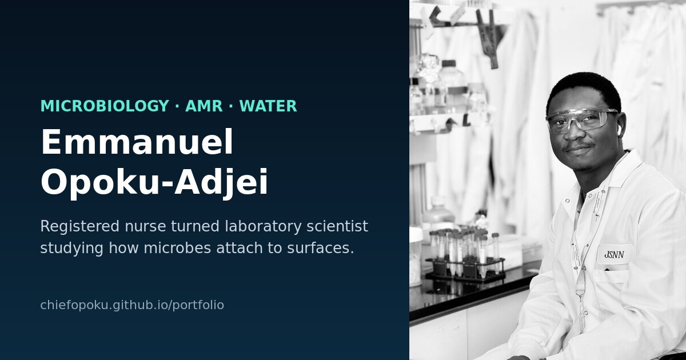

# Emmanuel Opoku-Adjei | Research Portfolio

**Live site:** https://chiefopoku.github.io/portfolio/



This is the personal research portfolio of Emmanuel Opoku-Adjei. He is a registered nurse turned laboratory scientist and an M.S. Nanoscience candidate at the Joint School of Nanoscience and Nanoengineering, UNC Greensboro.

His research is on microbial adhesion to surfaces, and his wider interests are antimicrobial resistance and water quality.

## What's on the site

| Section | Content |
| --- | --- |
| About | Background, from clinical nursing to laboratory research |
| News | Recent milestones |
| Interests | Research interests: microbial adhesion, AMR, water, environment |
| Research | Current projects in brief |
| Publications | Papers, with links to Google Scholar, ResearchGate and ORCID |
| Honors & Talks | Invited talks and awards |
| Experience | Interactive timeline, filterable by research, clinical and education |
| Gallery | Lab and conference photos with a lightbox |
| CV | Downloadable PDF |
| Contact | Email, LinkedIn, ORCID, Google Scholar, ResearchGate, GitHub |

## Features

- **Hero animation:** an interactive canvas. Microbes drift and stick to your cursor like cells adhering to a surface, and clicking releases a new cluster.
- **Themes:** light and dark modes, with a glass-style design.
- **Cards:** tilt and spotlight effects.
- **Navigation:** a scroll progress bar and smooth navigation that highlights the active section.
- **Experience timeline:** an animated rail that fills as you scroll.
- **Gallery:** category filters, a keyboard-navigable lightbox, and swipe on mobile.
- **Layout:** responsive, and it respects the "reduce motion" accessibility setting.
- **Search and sharing:** a social preview card, structured data (JSON-LD), a sitemap and a favicon.

## Built with

- HTML, CSS and vanilla JavaScript, with no frameworks and no build step.
- [Font Awesome](https://fontawesome.com/) for icons.
- Hosted on GitHub Pages.

## Project structure

```
index.html        all page content
styles.css        base styles and light/dark themes
script.js         theme toggle, typing effect, navigation, scroll spy
modern.css        modern layer: hero, cards, timeline, gallery
modern.js         microbe canvas, tilt cards, timeline, gallery lightbox
sitemap.xml
assets/
  Emmanuel_Opoku-Adjei_CV.pdf
  portrait_480.jpg, Emmanuel_lab_JSNN.jpg, JSNN_retreat_talk_2026.jpg
  og_preview.jpg  social media preview card
  favicon.svg
  gallery/        gNN.jpg (full size) and gNN_t.jpg (thumbnail)
```

## Run locally

Clone the repo and open `index.html` in a browser.

```bash
git clone https://github.com/Chiefopoku/portfolio.git
```

## Updating

- **Text:** edit `index.html`.
- **Styles or scripts:** after editing `modern.css` or `modern.js`, raise the `?v=` number in its link in `index.html` so browsers load the new version.
- **CV:** overwrite `assets/Emmanuel_Opoku-Adjei_CV.pdf`, keeping the same file name.
- **Gallery photo:** add `gNN.jpg` and a smaller `gNN_t.jpg` to `assets/gallery/`, then copy an existing gallery item in `index.html` and change its paths and caption.

## Contact

- Email: kwabenaopokujnr@gmail.com
- LinkedIn: https://www.linkedin.com/in/emmanuelopokuadjei/
- ORCID: https://orcid.org/0009-0008-2895-8719

© 2026 Emmanuel Opoku-Adjei. Content and images are not for reuse without permission.
